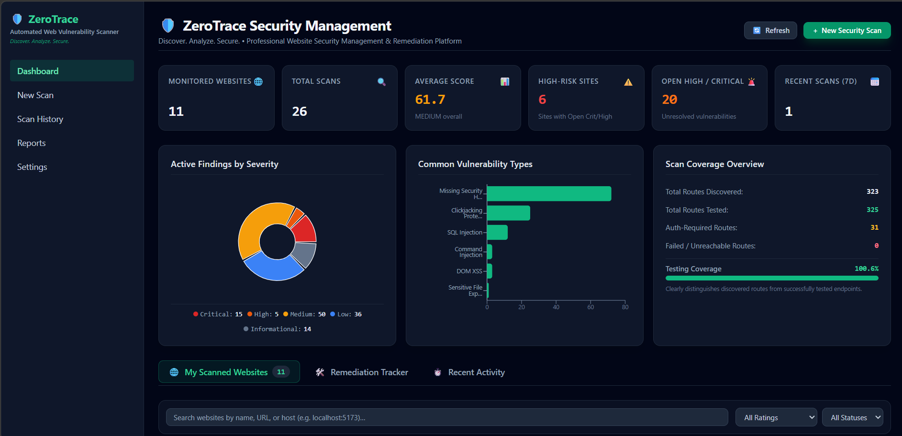
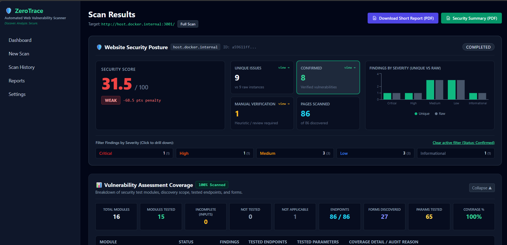
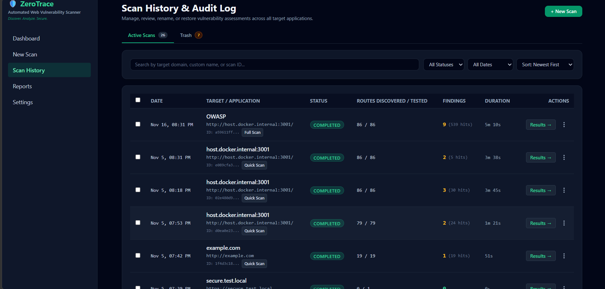
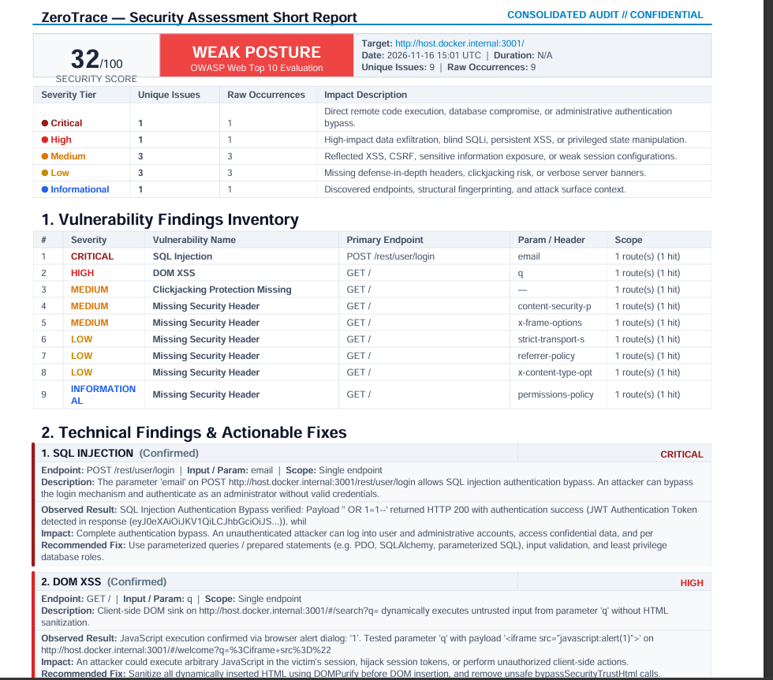

# ZeroTrace
### Automated Web Vulnerability Scanner

**Discover. Analyze. Secure.**

ZeroTrace is a Python-based automated web vulnerability scanner designed to identify, analyze, and report security weaknesses in web applications. It combines automated crawling, vulnerability detection, security posture analysis, and centralized reporting through a modern web dashboard.

The platform is designed to support security learners, developers, and security testers in assessing web application security within authorized testing environments.

---

## Screenshots

### 1. Dashboard


### 2. Scan Results


### 3. Scan History


### 4. PDF Security Report


---

## Key Features

### Automated Vulnerability Scanning
- Automated website crawling and endpoint discovery
- SPA-aware crawling using Playwright
- Form and parameter discovery
- Quick Scan and Full Scan modes
- Asynchronous vulnerability scanning

### Vulnerability Detection

ZeroTrace includes security checks for common web application vulnerabilities and misconfigurations:

| Vulnerability | Description |
|---|---|
| SQL Injection (SQLi) | Detects potential SQL injection weaknesses |
| Cross-Site Scripting (XSS) | Identifies potential script injection vulnerabilities |
| Clickjacking | Checks for clickjacking protection weaknesses |
| Command Injection | Tests for potential OS command injection |
| CSRF | Checks for cross-site request forgery weaknesses |
| Open Redirect | Identifies potentially unsafe redirects |
| Directory Listing | Detects exposed directory listings |
| Sensitive File Exposure | Checks for accessible sensitive files |
| Information Disclosure | Identifies unintended information exposure |
| Security Headers | Analyzes HTTP security header configurations |
| Cookie Security | Checks cookie security attributes |

*Detection coverage depends on the target application's behavior and the implemented scanning checks.*

### Security Analysis Dashboard
- Centralized website monitoring
- Security posture scoring
- Vulnerability severity classification
- Scan history and status tracking
- Finding lifecycle management
- Endpoint and vulnerability overview

### Reporting
- Short Website Scan Report (PDF)
- Security Summary Report (PDF)
- Consolidated vulnerability findings
- Evidence-based findings
- Remediation recommendations

### Additional Capabilities
- Asynchronous scanning
- PostgreSQL-based data persistence
- SSRF protection mechanisms
- Finding deduplication
- Scan result tracking
- Docker-based deployment

---

## System Architecture

```text
                 ┌─────────────────────────┐
                 │      React Frontend     │
                 │    Dashboard and UI     │
                 └────────────┬────────────┘
                              │
                              ▼
                 ┌─────────────────────────┐
                 │      FastAPI Backend    │
                 │       REST APIs         │
                 └────────────┬────────────┘
                              │
             ┌────────────────┼────────────────┐
             ▼                ▼                ▼
       ┌───────────┐   ┌──────────────┐  ┌──────────────┐
       │  Crawler  │   │ Vulnerability│  │   Security   │
       │ Playwright│   │  Detection   │  │   Analysis   │
       └───────────┘   └──────────────┘  └──────────────┘
                              │
                              ▼
                 ┌─────────────────────────┐
                 │       PostgreSQL        │
                 │    Persistent Storage   │
                 └────────────┬────────────┘
                              │
                              ▼
                 ┌─────────────────────────┐
                 │      PDF Reporting      │
                 └─────────────────────────┘
```

---

## Technology Stack

| Component | Technologies |
|---|---|
| Frontend | React, Vite, Tailwind CSS |
| Backend | Python, FastAPI |
| Database | PostgreSQL |
| Web Crawling | Playwright |
| Scanning | Python, AsyncIO |
| Reporting | ReportLab |
| Deployment | Docker, Docker Compose |

---

## Installation and Setup

### Prerequisites
- Python
- Node.js and npm
- Docker Desktop
- Git

### 1. Clone the Repository

```bash
git clone https://github.com/Rifthy2003/ZeroTrace.git
cd ZeroTrace
```

### 2. Configure Environment Variables

Configure the required environment variables and database credentials using the project's environment configuration files.

### 3. Start the Application

```bash
docker compose up --build
```

### 4. Access the Application

| Service | URL |
|---|---|
| Frontend | http://localhost:3000 |
| Backend API | http://localhost:8000 |
| API Documentation | http://localhost:8000/docs |

*The URLs above assume the default ports configured in Docker Compose.*

---

## Scanning Workflow

1. Add an authorized web application target.
2. Select Quick Scan or Full Scan.
3. Start the security assessment.
4. Allow ZeroTrace to crawl and analyze the application.
5. Review discovered vulnerabilities and security configuration issues.
6. Examine severity, evidence, and remediation recommendations.
7. Generate PDF security reports.

---

## Project Objectives

- Automate web application vulnerability assessment.
- Reduce the effort required for manual security testing.
- Identify common web application security weaknesses.
- Provide understandable findings and remediation guidance.
- Present assessment results through a centralized dashboard.

---

## Security and Responsible Use

ZeroTrace is intended for authorized security testing, educational purposes, and controlled environments.

- Only scan websites and applications you own or have explicit permission to test.
- Respect the scope and rules of engagement of security testing programs.
- Do not scan systems without authorization.

---

## Author

**Rifthy**

Computer Engineering Undergraduate  
Cybersecurity | Web Application Security | Security Automation

GitHub: [@Rifthy2003](https://github.com/Rifthy2003)

---

## Disclaimer

ZeroTrace is a security assessment tool and does not guarantee the detection of every vulnerability. Findings should be validated through appropriate manual security testing.

**Discover. Analyze. Secure.**
